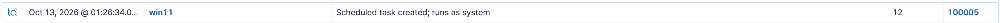

## Attack
- `schtasks /create /tn "WindowsUpdater" /tr "C:\Windows\System32\calc.exe" /sc onlogon /ru System`

## Detection
- Produced event 4698
- Produced Windows Security event 4698 ("a scheduled task was created"), caught by built-in rule 60228
- Chose 4698 over the Sysmon process event because 4698 captures the task's full definition (what it runs, and the account it runs as) in the taskContent field

## The Gap
4698 didn’t log until I enabled “Audit Other Object Access Events.”

## My Rule
**Rule 100005:**
```xml
  <rule id="100005" level="12">
    <if_sid>60228</if_sid>
    <field name="win.eventdata.taskContent">S-1-5-18</field>
    <field name="win.eventdata.taskContent">calc.exe</field>
    <description>Scheduled task created; runs as system</description>
    <mitre><id>T1053.005</id></mitre>
  </rule>
```
S-1-5-18 is the SYSTEM account SID (the /ru System part); calc.exe is the task's payload

## Known Limitation
The rule requires /ru System; a task running as the normal user would slip past

## Result
Custom Rule triggered at level 12 when scheduled task was created and ran at system level


## MITRE
- T1053.005 (Scheduled Task)
