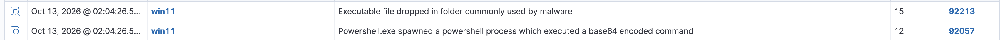

## Attack
- Encoded/obfuscated PowerShell using common evasion flags:
  `powershell.exe -NoProfile -ExecutionPolicy Bypass -EncodedCommand <base64>`
- Flags: `-NoProfile` (skip profile/configs), `-ExecutionPolicy Bypass` (ignore script policy), `-EncodedCommand` (Base64-encode the command so the real text isn't visible). Decoded payload was a harmless Write-Host.

## Detection
- Caught by built-in rule 92057 (level 12): "Powershell.exe spawned a powershell process which executed a base64 encoded command"
- Wazuh already detects this technique; no custom rule needed

## Finding: severity inversion (tuning issue)
- A second rule, 92213 (level 15, "Executable file dropped in folder commonly used by malware"), also fired

## Result
- No need for a custom rule; default was sufficient

## MITRE
- T1059.001 (Command and Scripting Interpreter: PowerShell)
